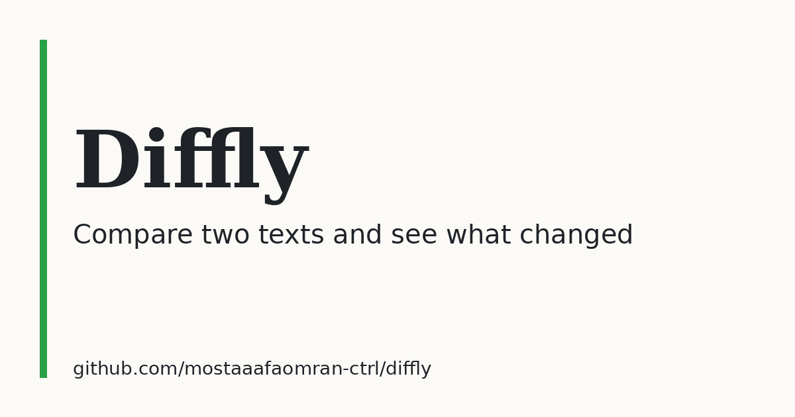

# Diffly

Compare two texts and see what changed.

 

**Live demo:** https://mostaaafaomran-ctrl.github.io/diffly/ (add `?demo=1` to see it filled with sample data)

Paste two versions of text or code, see added and removed lines with word-level highlights. Split or unified view.

## Features

- Line diff with word-level highlights
- Split and unified views
- Ignore whitespace and ignore case options
- Copy the result as a unified diff
- Works offline, nothing is sent anywhere

## Run it locally

It is one `index.html` file. Open it in a browser. No build step, no dependencies, no server.

## Privacy

Everything runs in your browser. Nothing is uploaded. Data you enter is kept in your browser's local storage on your device only.

## بالعربي

حط نسختين من نص أو كود وشوف إيه اتضاف وإيه اتشال سطر بسطر وكلمة بكلمة.

افتح الملف `index.html` في المتصفح وهيشتغل على طول، من غير تسجيل ومن غير سيرفر.

## License

MIT
